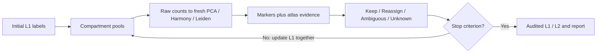

# OmicsAgent

Auditable scRNA-seq and spatial transcriptomics workflows, with optional bounded Claude tool use.

**v0.3.0: initial public experimental release.** Numerical analysis works without an API key. The new iterative hierarchical annotation stage refines coarse L1 and subtype L2 labels by rebuilding compartment clusters from raw counts and comparing marker evidence with external reference transfer. Real ISD skin-atlas validation is pending.

## A three-minute scientist review

[Explore three measured cases](docs/cases/README.md): agreement, conflicting evidence, and insufficient evidence from one licensed public Tabula Sapiens bone marrow dataset. The offline interactive report separates coarse identity from subtype uncertainty, shows support and counterevidence, and suggests a next check only when recorded observations trigger it. Accept/undo preserves original labels and exports a run-scoped review history.

[Walkthrough and design rationale](docs/SCIENTIST_REVIEW.md). These selected examples demonstrate decision behavior; published atlas labels are not independent biological ground truth.

```bash
omicsagent prepare-review --out data/scientist-review
omicsagent run --config data/scientist-review/run.json
omicsagent evaluate-review
```

Preparation downloads a pinned public count dataset; no model API key is required. Open `data/scientist-review/run/report.html`. Each hierarchical run now also generates `review.json` and an offline HTML report alongside the existing Markdown and notebook outputs.

## Quick start

Python 3.11-3.13 is supported. Use [uv](https://docs.astral.sh/uv/) or install the package with pip.

```bash
git clone https://github.com/ShaolongCao/OmicsAgent.git
cd OmicsAgent
uv sync --frozen --no-editable --extra dev --extra hierarchy
source .venv/bin/activate
omicsagent doctor
omicsagent hierarchy-demo --out data/my-hierarchy
omicsagent run --config data/my-hierarchy/scrna.json
omicsagent run --config data/my-hierarchy/imaging.json
```

Open each output directory's `report.md`, `analysis.ipynb`, `result.h5ad` and `hierarchy/decisions.csv`. The demo generates independent synthetic reference/query counts and deliberately misplaced initial L1 labels. It demonstrates mechanics, not biological accuracy. Use a new output directory for each run.

[Complete tutorial](docs/HIERARCHY_TUTORIAL.md) · [Methods](docs/methods.md) · [Validation](docs/validation-v03.md) · [Skills](docs/skills.md)

## Capabilities

| Area | Implementation |
|---|---|
| scRNA-seq | Raw-count validation, QC, normalization/log1p, HVG/PCA, neighbors, Leiden, UMAP, full-gene markers |
| Initial annotation | Marker panels, provided labels, reference-fitted PCA/KNN, optional scANVI or TACCO |
| Hierarchical annotation | Fresh pool clustering per round, optional Harmony, L1/L2 module scores and detection support, independent atlas transfer, synchronous reassignments, explicit abstention and stopping reasons |
| Spatial | Sample-isolated graphs, label enrichment, Moran I and optional center niches; imaging cell labels or Visium expression domains |
| SPLIT core | Optional Python implementation of standard RCTD-free purification; fractional correction layer remains separate from raw counts |
| Evidence and agent | Cached Ensembl/Europe PMC queries; bounded Claude tools, selected method skills and JSONL traces |
| Reproducibility | Fixed config, input/code/artifact hashes, dependency versions, tables, figures, saved model outputs and offline notebook replay |

Hierarchy transfer uses a reference-fitted PCA/KNN backend in this release. Existing scANVI/TACCO adapters remain available for initial annotation; hierarchy does not silently substitute them for its independent reference evidence.



Reassignment requires strong marker evidence and consistent reference support. Atlas labels cannot override failed marker evidence. Default limits are three rounds and no moving cluster larger than 0.5% of its source pool. Cycles and iteration limits are distinguished from stability. Numerical stability is not biological validation.

## Optional methods

```bash
uv sync --frozen --no-editable --extra dev --extra hierarchy --extra scanvi --extra tacco
source .venv/bin/activate
omicsagent demo --out data/optional-demo
omicsagent run --config data/optional-demo/scanvi-scrna.json
omicsagent run --config data/optional-demo/tacco-split.json
```

The scANVI demo trains only two epochs per stage. It is not a convergence or annotation-quality benchmark. TACCO weights and classifier posteriors are not calibrated correctness probabilities. SPLIT here is a Python core port; native R parity and aggressive residual removal are not implemented.

## Claude orchestration

Set `ANTHROPIC_API_KEY` in your environment using your normal secret-management workflow; never put credentials in configs or Git. Set `model` to a model available to your account and choose a fresh output directory, then run:

```bash
omicsagent agent --config path/to/run.json
```

Agent mode calls the same fixed-config tools as deterministic runs. It cannot execute arbitrary code or change scientific thresholds. Real API calls require your own account and may incur provider charges. Tests use a mock client; no real Claude validation is claimed.

## Scientific limits

- All annotations remain provisional. Use tissue-appropriate marker panels, compatible references and held-out biological samples.
- Hierarchy scores use fixed-query standardization; behavior depends on query composition and panel coverage.
- Missing markers/controls, tiny pools and conflicting evidence produce unresolved calls.
- Visium spots are mixed expression domains, not single cells. Domain mode is mandatory for hierarchical Visium runs.
- Hierarchy uses original raw counts; it does not rerun SPLIT or use fractional corrected counts for scANVI.
- No real ISD validation, native R SPLIT validation, trajectory inference, SPATA2, MCP server or hosted web application is included.

## Development

```bash
uv sync --frozen --no-editable --extra dev --extra hierarchy
source .venv/bin/activate
pytest -q
ruff check src tests scripts
mypy src/omicsagent
```

Optional TACCO tests skip when the extra is absent. Public CI and local optional-method runs are reported separately. Only allowlisted English source, tests, examples and documentation are published; private data, outputs, environments and credentials are excluded.
